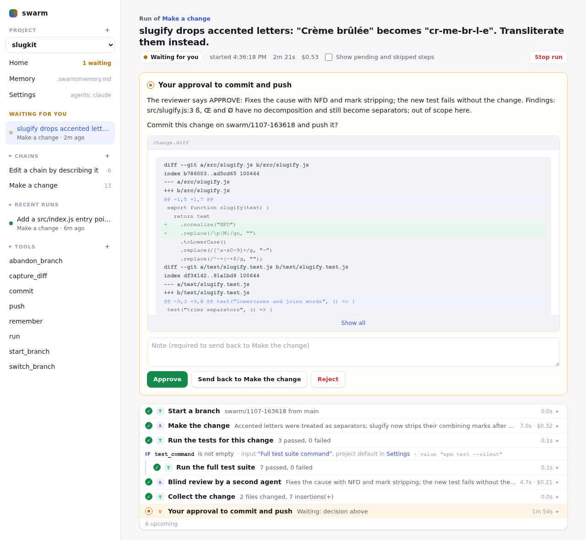

# swarm

Stop babysitting your coding agent. swarm makes the change, runs the tests, has a second agent review it, and asks you before it commits.



## Features

- **Build chains of steps** - Mix agent steps, shell commands and approval steps. The included `make-change` chain makes a change on a branch, runs the tests, has a second agent review it, and asks you before it commits and pushes.
- **Use any agent** - Claude Code, Codex or any other agent CLI. Steps in one chain can use different agents.
- **Watch runs live** - Each step's status, output, duration and cost, and every tool call an agent made.
- **Approve before commit** - Approval steps show the diff and any screenshots or videos a step produced. Approve, reject, or send the work back to an earlier step with a note.
- **Answer agent questions** - An agent can stop and ask you questions, then continue in the same session once you answer.
- **Branch, loop and fan out** - Skip steps by condition, repeat fix and review until the reviewer approves, or run a chain once per item in a list, sequentially or in parallel.
- **Rerun from any step** - Earlier attempts are kept.
- **Build memory automatically** - Runs add notes to the project's memory file, and later runs read it.
- **Edit chains in plain words** - Describe the change; the `edit-chain` chain has an agent make it, and you approve the diff.
- **Dry-run chains** - `swarm test` walks through a chain with mocked agent answers and runs nothing.
- **Script everything** - Everything on the page is also in the `swarm` CLI, so scripts and agents can use it.
- **Single binary** - For Linux and macOS. Chains, prompts and tools live in your repo under `.swarm/`.

## Install

Download a build from [Releases](https://github.com/adam-ah/agent_swarm/releases) and put `swarm` on your `PATH`, or build from source (Go 1.23+):

```bash
cd src && go build -o ~/.local/bin/swarm .
```

## Start

```bash
swarm samples                 # sample chains, tools and the guide into ~/.swarm
swarm init                    # make the current folder a project
swarm serve                   # the page, on http://127.0.0.1:7070
swarm run make-change -input request="..."
```

`swarm help` lists commands. `swarm guide` documents the file formats; it is written for agents too.

The page has no login. Keep it on `127.0.0.1` unless every machine that can reach the port is trusted.

## License

MIT
